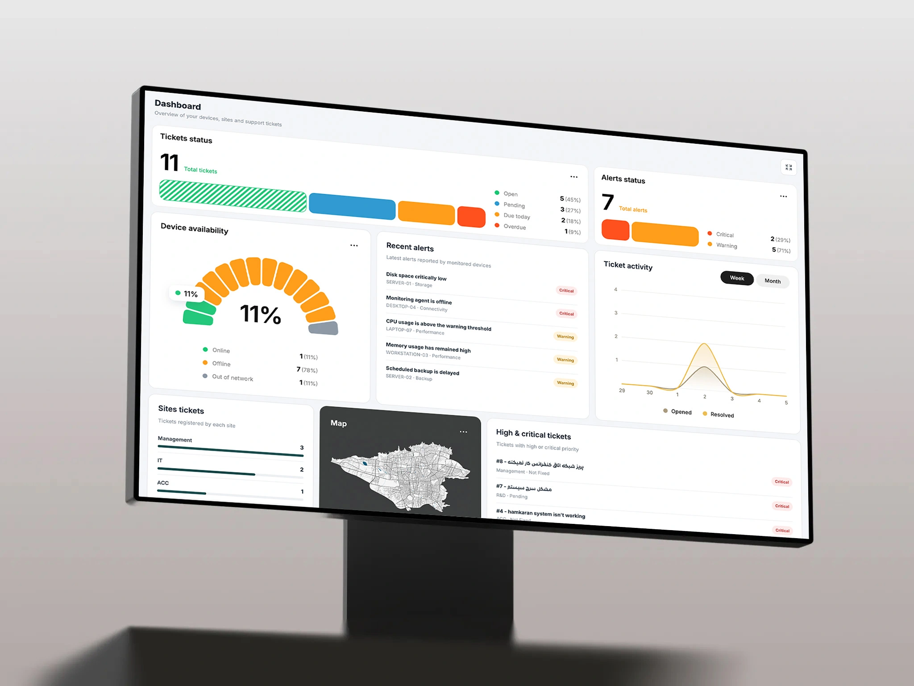
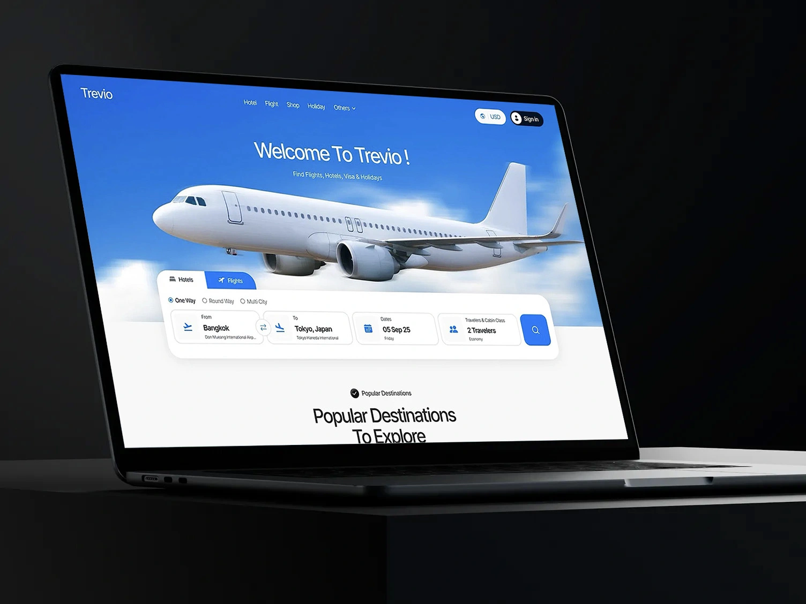

# Hi there, I'm Ali 👋

**Backend-Focused Developer • Web Applications & SaaS**

I'm building web applications and exploring SaaS ideas that solve real-world problems. One of my main projects is **[AioDesk](https://rmm.aiodesk.ir)**, an RMM and IT management platform focused on device monitoring, alerts, and IT support workflows. I'm also exploring **[Torob Trip](https://aiodesk.ir)**, a concept for discovering and comparing travel options across providers.

### 🎯 Currently
- 🚀 Building practical web applications and SaaS projects.
- 🧩 Working on backend systems and software architecture.
- 💡 Exploring product ideas at the intersection of software, IT, and business.

### 🌟 Featured Projectssss

<table>
<tr>
<td width="50%" valign="top">

### 🖥️ [AioDesk — RMM & IT Management](https://aiodesk.ir)

`Python` `FastAPI` `SQLite` `Redis` `RabbitMQ` `Docker`

**In development** — A web-based platform for managing IT endpoints, infrastructure, and support workflows.

- Device and asset inventory with agent-based reporting
- Infrastructure monitoring, alerts, and ticketing
- Network discovery, patch inventory, and backup awareness
- Modular backend and background processing

</td>
<td width="50%" valign="top">

### ✈️ [Torob Trip — Travel Comparison Platform](https://aiodesk.ir)

`Django` `PostgreSQL` `REST API`

**Concept / planned project** — A travel discovery and comparison platform that aims to bring offers from different providers into one searchable experience.

- Search and compare flights and travel options
- Normalize listings from multiple sources
- Filter and rank results by traveler preferences
- Explore transparent, AI-assisted recommendations

</td>
</tr>
</table>

### 🧰 Tech Stack

**Languages & Frameworks**  
  

**Backend & Concepts**  
     

**Data & Messaging**  
    

**Tools & Environments**  
   -E95420?style=for-the-badge&logo=ubuntu&logoColor=white)   

**Beyond the Backend**  
   

### 📖 Education
- **Kharazmi University**: B.Sc. in Computer Science (2023 - 2027)
- **National Organization for Development of Exceptional Talents (Sampad)**: Diploma in Mathematics (2019 - 2023)

## 📫 Let's Connect

